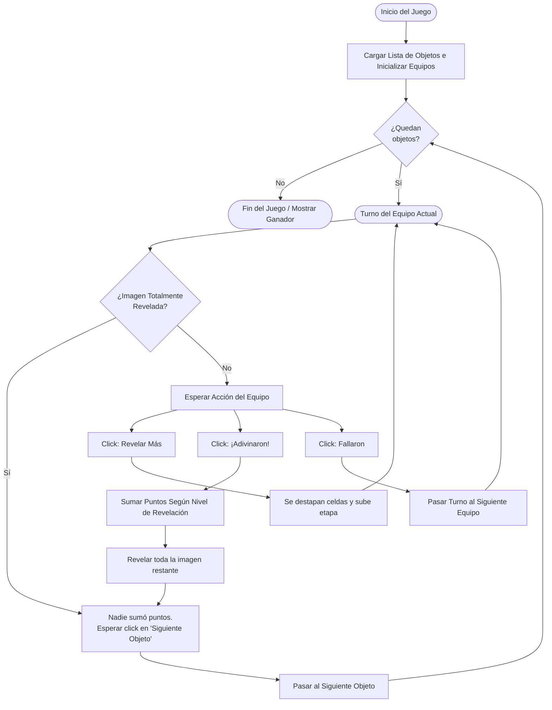

# Árbol de Decisión / Flujo del Juego: ¿Qué objeto es?

Este diagrama ilustra el flujo lógico y el sistema de decisiones y puntuación para el minijuego de adivinanzas, documentado según la dinámica real del código en HTML/JS.



## Sistema de Puntuación (Etapas de Revelación)

El nodo **Sumar Puntos Según Nivel de Revelación** sigue la siguiente regla lógica internamente:

```mermaid
flowchart LR
    Stage{Nivel de Revelación\n(revealStage)}
    Stage -- "0 o 1 (Poca Info)" --> P3[Otorgar 3 Puntos]
    Stage -- "2 (Info Intermedia)" --> P2[Otorgar 2 Puntos]
    Stage -- "3 (Casi Revelado)" --> P1[Otorgar 1 Punto]
    Stage -- "4+ (Todo Revelado)" --> P0[Otorgar 0 Puntos]
```
